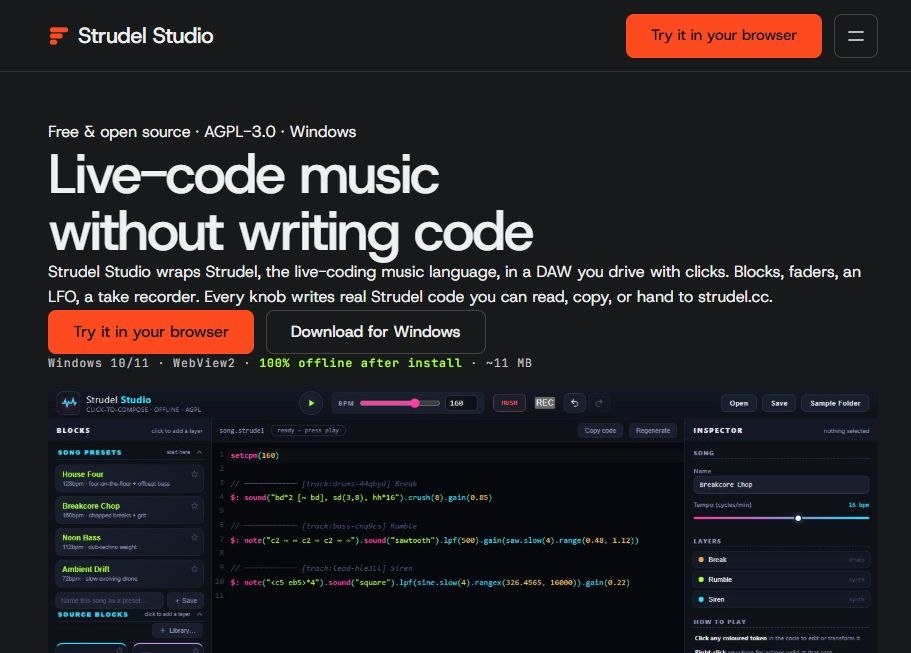

# Strudel Studio

[](https://r3naldocreates.github.io/strudel-studio/)



**→ [Open Strudel Studio — compose music without writing code](https://r3naldocreates.github.io/strudel-studio/)** · [Try it in your browser, no download](https://r3naldocreates.github.io/strudel-studio/demo/) · [Get the Windows release](https://github.com/R3naldoCreates/strudel-studio/releases/latest)

**A click-to-compose desktop interface for [Strudel](https://strudel.cc), the
live-coding music environment — fully offline, built in Rust + TypeScript.**

Strudel live-coding is the most expressive way to make algorithmic music — and
the least approachable. Strudel Studio wraps the real Strudel engine in a
DAW-style instrument: blocks, strips, faders, waveforms and context menus,
where every control writes real Strudel code you can read, copy, or hand to
strudel.cc itself.


%20·%20Rust-orange)

---

## What is this?

- **Left sidebar — everything, collapsible**:
  - **Song Presets**: 4 built-in starting points (collapsed by default) — and
    **＋ Save** stores the current song as your own preset, persisted locally.
  - **Source Blocks**: 17 pre-wired layers (four-on-the-floor kit, acid bass,
    supersaw lead, synth kick…); star any of them to pin it above everything.
  - **Instrument Library**: all **125 General MIDI soundfonts** (piano, brass,
    strings, ethnic, sfx…) grouped by family with search — plus **80+ VCSL
    orchestral/world instruments** (Steinway, tenor sax, marimba, mridangam…).
    They stream from the web on first use; the bundled kit stays offline.
    Plus one-click registration for the downloadable sample banks
    (VCSL, Tidal Drum Machines, Dirt-Samples, Mridangam, Piano, E-mu SP-12).
  - **Mini-notation cheat sheet**: the complete notation set (docs-verified)
    organized into groups you can collapse, a **Commonly Used** main set,
    **★ favorites**, and your own custom rows you can add/delete.
- **Paste a Bakery example - layers appear**: copy any strudel.cc `Bakery` snippet and paste it into the editor. Strudel Studio parses it, proposes the matching layers (drum statements verbatim, one synth layer per instrument, tempo from setcpm/setcps, sample banks baked into the song), lists the instruments it can't find with tickboxes to download, and either imports as layers or pastes as-is with one click.
- **Center — Code, but legible**: the actual strudel code your song generates,
  with strudel syntax highlighting. **Fired tokens light up inline as they play**
  (strudel.cc-style box highlight), and playing layers pulse on the timeline.
  **Click any coloured token** to get a menu of actions valid right there;
  **click empty space** to add a layer.
- **Live sliders**: type `slider(0.5, 0, 1)` anywhere (or hand-edit it in) and a
  draggable knob appears above the editor — drag to perform, exactly like
  strudel.cc's built-in widgets.
- **Right sidebar — Inspector**: pattern editors with notation palettes, a
  note grid, a **sample bank picker with waveform previews**, waveform/shape
  pickers, gain, a full effect chain with per-FX **bypass (mute) and LFO
  automation**, and a unified **Layer Contents** list showing everything added to
  the layer with one-click remove/bypass.
- **Everything is undoable** — `Ctrl+Z` / `Ctrl+Shift+Z` across tracks, effects,
  automation, patterns, presets and loads.
- **Bottom — Scope + Timeline**: a live output oscilloscope (wave / spectrum)
  over **dynamically expanding track strips**: mute, solo, drag faders,
  FX chips, LFO badges. Strips appear and disappear with your layers.

Every edit hot-swaps the pattern **while the music plays**. What you see in
the editor is exactly what the engine hears.

The built-in content is meant to be played, not just clicked:

- **Song presets** are complete little arrangements — House, Techno, Boom Bap,
  Drum & Bass and Ambient — each with a real chord progression, a bass that
  follows the roots and a drum groove that fits the style. **Drum & Bass —
  Rollout** starts with a 10-second pad/stab intro, then the break and sub drop
  in and keep playing (a `mask(time.segment(1).gt(N))` gate, written as real
  Strudel code on those two layers).
- Drum patterns follow Strudel's own workshop examples rather than made-up
  patterns: house is `bd*4, [- cp]*2, [- hh]*4` (clap on 2 & 4, **offbeat**
  hats), the rock kit is `[bd sd]*2, hh*8`, and the DnB break is a steady
  16-step two-step with ghost snares. Tempo uses Strudel's 4/4 convention —
  `setcpm(bpm / 4)`, one bar per cycle — so nothing runs four times too fast.
- **Source blocks** are usable musical ideas (four-on-the-floor, backbeat,
  acid line, chord arp, filter pad…) rather than random note clouds.
- The **mini-notation cheat sheet** was rewritten from the strudel.cc docs:
  a practical Commonly Used set plus groups for sequencing, speed, weight,
  rests/chords, randomness, Euclidean rhythms, notes/samples and pattern
  functions. Click a mini-notation row to append it to the selected layer;
  rows marked **JS** are reference only (paste them into the code editor —
  they are not mini-notation and would silence a pattern).
- `slider()` calls render as **inline controls inside the code**, exactly like
  strudel.cc — drag one and the source value changes under it while playing.
- The **inspector home button** (top-left) returns to song name and tempo from
  any layer. The recorder's **X** closes it; REC or the top-bar pill reopens it.

## Pasting someone else's code — safety, with the full snippet kept

Paste any Bakery / example snippet from strudel.cc into the editor and the
import dialog checks it **before** anything is added:

- **Code safety first.** Anything that reaches outside Strudel — Tauri IPC,
  file access, network requests, `eval`/dynamic imports, browser storage,
  `window`/`document` access — is listed in red with the exact line and why it
  is risky. Tick **Leave it in** for any item you trust; everything else is
  removed by default. The live preview marks removed code red and kept code amber.
- **Full pasted code is the default import mode.** The whole snippet is kept
  verbatim and plays exactly as it does on the strudel.cc example page —
  including `setcpm`, `samples({...})`, `slider()`, `.bank()` and anything the
  layer mapper does not understand. **Editable layers** remains available when
  you want strips and inspectors.
- **Nothing is removed silently.** Every omitted snippet is written into the
  song as a `// ⚠ omitted from pasted code:` comment and survives save/reload.
- **Opening a shared `.strudel.json` gets the same check**, with a confirm
  dialog before any unsafe code is loaded.
- The **Sample Folder** button uses a native directory picker on desktop;
  the webview is granted asset access only to the folder you choose.

The desktop build also runs with a Content Security Policy, file IPC limited to
`.json` song files, and a minimized asset-protocol scope. The GM soundfont
loader parses its CDN data as data (no `eval`) so it works under that policy.

## Can I run Strudel offline?

Yes — that's a first-class feature:

1. **This app bundles the Strudel engine** (`@strudel/web` from npm) and a
   starter drum kit. After `npm install`, no network is needed to run it.
2. Instrument Library (left sidebar): play **GM soundfonts** and VCSL instruments
   like `note("c3 eb3 g3").sound("gm_piano")` — streams from the web on first
   play; cached by the browser afterwards.
3. Your own samples: click **Sample Folder** and point at a folder of
   `.wav/.mp3/.ogg/.flac/…`. Subfolders become banks (`drums/`, `bass/…`);
   files register instantly. Everything stays on your disk.
4. strudel.cc itself also works offline as a PWA — but then you lose this
   interface; this app is the interface.

## Quick start

**Just want to try it?** → **[Try Strudel Studio in your browser](https://r3naldocreates.github.io/strudel-studio/demo/)** (no download, works offline after first load)
**Just want the app?** → **[Download the latest Windows release](https://github.com/r3naldocreates/strudel-studio/releases/latest)** (requires WebView2, preinstalled on Windows 11)
Or build it yourself:

```powershell
cd E:\projects\Apps\Strudel
npm install          # if prompted about blocked install scripts (Windows):
                     # approve "esbuild" — Vite needs its binary
npm run tauri dev    # desktop app with hot reload
npm run tauri build  # installer/bundle → src-tauri/target/release/
```

**Other ways to get it:** download the portable EXE from the [Releases](https://github.com/r3naldocreates/strudel-studio/releases/latest) page and run it anywhere — no installer needed — or clone this repo and `npm run tauri build`. The browser demo is the full app, minus desktop file integration.

Browser-only dev (no Rust): `npm run dev` → http://127.0.0.1:1420
Safety/parser checks: `npm test` (zero dependencies; needs Node 22.6+ for TypeScript type stripping — the app itself builds on Node 18+)

Requirements: Windows + [WebView2](https://developer.microsoft.com/microsoft-edge/webview2/)
(preinstalled on Win 11), Node 18+, Rust 1.77+ with MSVC Build Tools.

## Using the thing

1. **Press Play** (or `Ctrl+Enter`). A starter groove plays: kick pattern,
   square bass, swept saw lead.
2. **Click blocks** on the left — each adds a layer to the timeline below.
3. **Click the code**: `"bd ~ sd ~, hh*8"` → drum inserts (`*2`, euclidean
   `(3,8)`, groups…), on `.gain(…)` → trim or add a **gain LFO**, on `.lpf(…)`
   → "Automate with LFO", on empty space → add-layer menu.
4. **Timeline**: `M` mutes, `S` solos, drag faders (double-click resets),
   the squiggle toggles a sine LFO, FX chips open the inspector.
5. **Save** (`Ctrl+S`) writes a portable `song.strudel.json`.

## Sample folder layout

```
my-samples/
  drums/        ← bank "drums": bd.wav sd.wav hh.wav…
  bass/         ← bank "bass"…
  oneshot.wav   ← root files land in a bank named after the folder
```

Sound names = file names (sanitized, de-duplicated). `n` variations are only
available for multisampled entries in bundled kit packs.

## Architecture (and honesty about "fully Rust")

| Piece | Tech |
|---|---|
| App shell, file dialogs, sample-folder scanner, security | **Rust (Tauri v2)** |
| Audio engine | `@strudel/web` — the real strudel engine, bundled |
| Song model → strudel source + click-spans | TypeScript (single source of truth) |
| UI panels | TypeScript + CodeMirror 6 |

The Strudel engine is JavaScript by nature (AGPL-3.0). Everything that can be
Rust here is Rust; the engine can't be without becoming a different product.
A native engine swap is designed-for but explicitly Phase 6 — see `PLAN.md`.

### Known limits v0.1

- Mute = commented-out `$:` line (strudel has no per-pattern mute).
- Hand-editing code is allowed; the model stays ahead until your next GUI action.
- Sample banks register bare names; `bank()` prefixing is roadmapped.
- One LFO slot per track (nearest-FX LFO or gain LFO).

## How this relates to Strudel

Strudel Studio is **not a fork, a replacement, or a competitor** — it's a GUI
on top of [Strudel](https://strudel.cc), the live-coding music environment by
the Strudel community. Every sound, scheduler, pattern engine and soundfont is
the real `@strudel/*` engine, embedded unmodified. This project exists to make
Strudel reachable for musicians who don't want to write code, and to give back
work the community can use, study and extend — everything here is AGPL-3.0,
exactly like Strudel itself. **Go make music with the instrument; this is the
friendly interface to it.**

## Legal & license

Strudel Studio is a derivative of **Strudel** (AGPL-3.0-or-later) and is itself
released under the **GNU Affero General Public License v3** — see `LICENSE`.
If you distribute this app or run it as a network service, you must share the
corresponding source under the same license.

- Strudel: <https://codeberg.org/uzu/strudel> (AGPL-3.0)
- Bundled samples: [`uzu-drumkit`](https://github.com/tidalcycles/uzu-drumkit) (see upstream for terms)
- This project: not affiliated with the Strudel project. Trademarks belong to their owners.

## Contributing

PRs welcome. Read `PLAN.md` for the roadmap and the design principles —
(1) the model is the truth, (2) no silent audio changes, (3) every control
writes real strudel, (4) offline by default, (5) AGPL forever.
